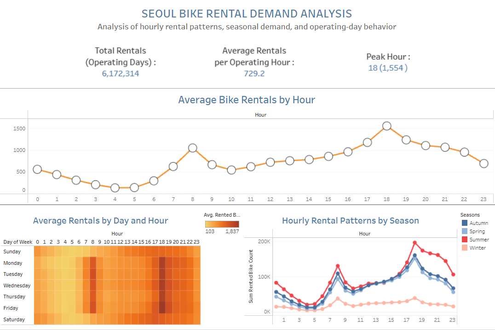

# Seoul Bike Rental Demand Analysis

An exploratory data analysis project examining hourly bicycle rental demand, seasonal variation, and weekday-versus-weekend patterns using Google Sheets and Tableau Public.

## Project Overview

Understanding rental demand is important for planning bicycle availability and daily operations. This project explores rental patterns in Seoul to identify peak hours, compare seasonal demand, and examine differences between weekdays and weekends.

The analysis uses spreadsheet-based data preparation, lookup formulas, Pivot Tables, KPI summaries, and an interactive Tableau dashboard to communicate findings and preliminary business recommendations.

## Business Questions

- At what hours is bicycle rental demand highest and lowest?
- How does average rental demand vary across seasons?
- How do weekday and weekend rental patterns differ?
- What operational considerations can be derived from these patterns?

## Tools & Skills

- **Google Sheets:** data preparation, calculated columns, `VLOOKUP`, Pivot Tables, KPI summaries.
- **Tableau Public:** data visualization, dashboard design, and exploratory analysis.
- **Analytical skills:** exploratory data analysis (EDA), trend analysis, data interpretation, and business recommendations.

## Dataset

The dataset contains 8,760 hourly observations and 14 original columns, including rental counts, date and hour information, season, holiday status, functioning-day status, and weather-related variables.

Please refer to the original dataset source and its license before redistributing the raw data.

## Dashboard Preview

**Interactive dashboard:** [Tableau Public dashboard URL](https://public.tableau.com/app/profile/jason.tchandra/viz/project_2_17912834275080/Dashboard1)

## Key Findings

### 1. Evening Peak in Rental Demand

Average rentals peaked at approximately **1,554.02 at 6:00 PM**. A secondary morning peak occurred at 8:00 AM, with approximately 1,050.23 average rentals.

### 2. Seasonal Variation

The seasonal Pivot Table reported the following overall averages:

| Season | Average Rentals |
|---|---:|
| Summer | 1,034.07 |
| Autumn | 924.11 |
| Spring | 746.25 |
| Winter | 225.54 |

Summer had the highest average rental count, while Winter had the lowest.

### 3. Weekday and Weekend Differences

Weekday demand was notably higher at 8:00 AM and 6:00 PM. Weekend demand exceeded weekday demand during several midday hours, including 3:00 PM.

These results indicate that rental patterns vary by hour, season, and day type.

## Business Recommendations

- Review bicycle availability before morning and evening peak hours.
- Consider seasonal demand patterns when planning fleet readiness and maintenance.
- Evaluate different redistribution schedules for weekdays and weekends.
- Validate proposed operational changes using station-level demand and availability data.

These recommendations are preliminary. The analysis describes observed patterns and does not establish their causes.

## Project Files

- [`Project Report`](report/Seoul_Bike_Rental_Demand_Analysis_Report.pdf) — methodology, findings, recommendations, and limitations.
- [`Analysis Documentation`](analysis/README.md) — data preparation and spreadsheet analysis process.
- [`Dashboard Screenshot`](images/dashboard.png) — static dashboard preview.

**Google Sheets workbook:** [Google Sheets URL](https://docs.google.com/spreadsheets/d/1Ji-ZyqzxgPw8p7fNVxRslvXsO86sjpgLevAsxUxCMZA/edit?usp=sharing)

## Limitations

This project focuses on aggregate rental patterns by hour, season, and day type. It does not identify station-level shortages or establish causal relationships. Additional station-level and operational data would be needed to develop more specific recommendations.

## Conclusion

This project demonstrates a spreadsheet-based analytical workflow, from data preparation and aggregation to dashboard visualization and business-oriented interpretation. It highlights how Google Sheets and Tableau Public can be combined to communicate data-driven findings.
